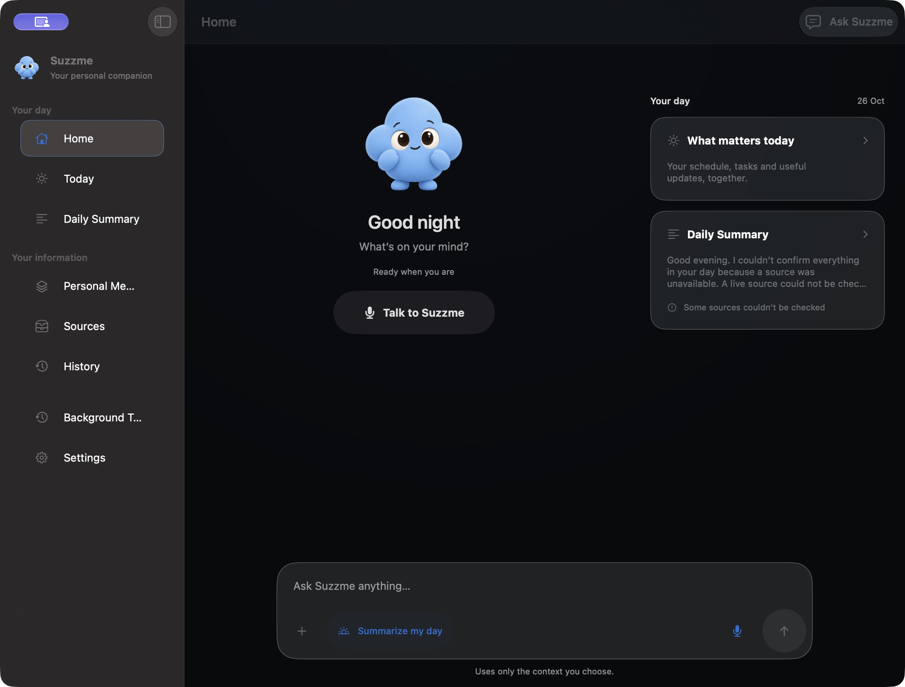
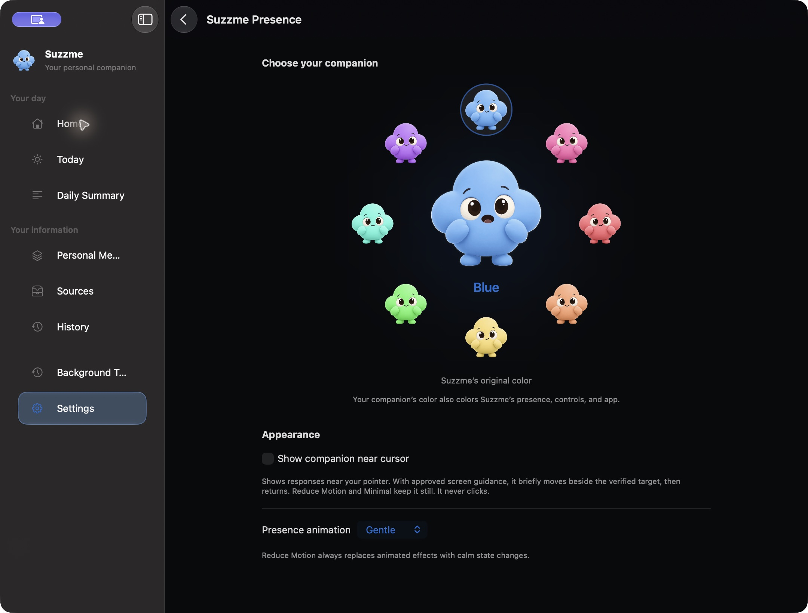
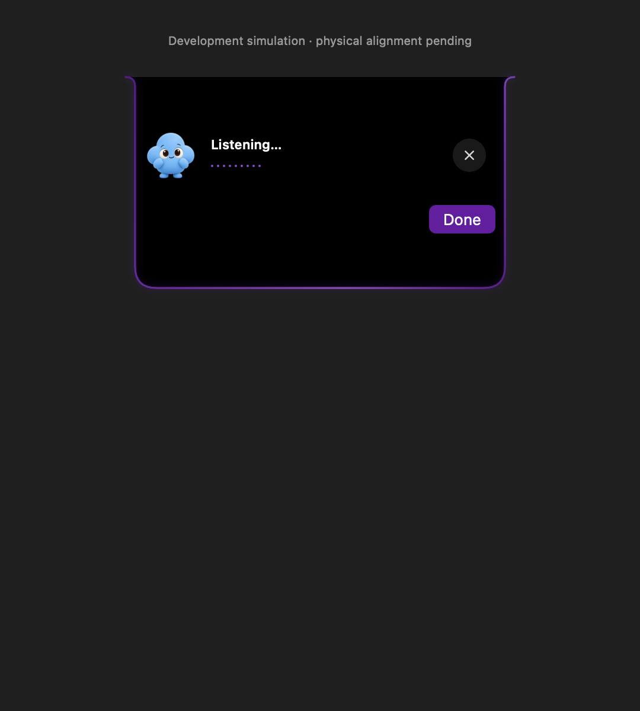
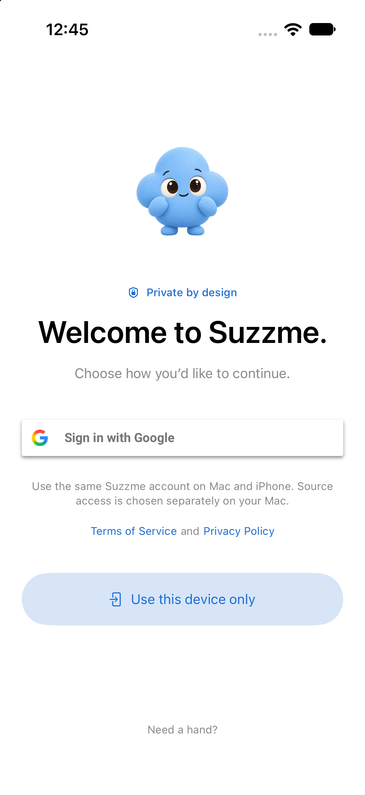
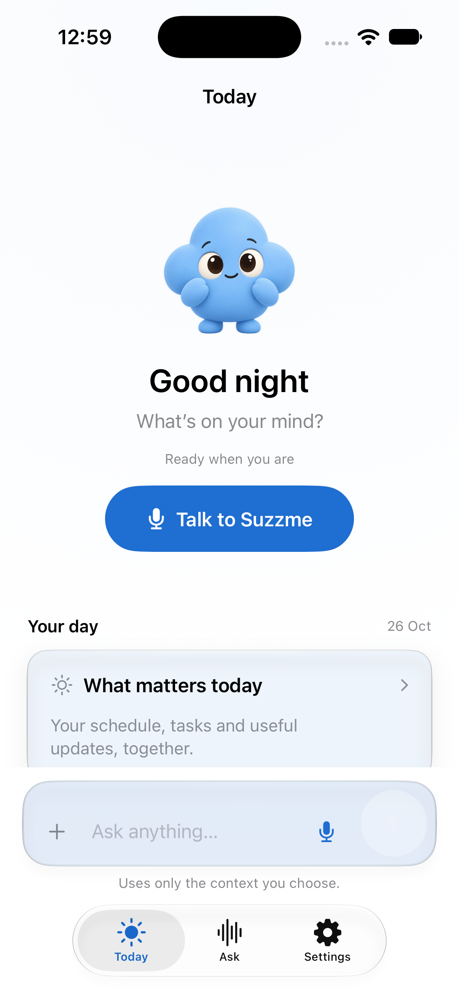

# Suzzme

<p align="center">
  
</p>

<p align="center">
  <strong>Native, privacy-first personal intelligence layer for macOS & iOS</strong>
</p>

<p align="center">
  
  
  
  
  
</p>

---

## 🌟 Overview

**Suzzme** is an honest, privacy-first personal assistant designed specifically for Apple platforms. It synthesizes what is happening across your authorized digital tools, remembers what matters, delivers calm daily briefings, and safely executes verified actions—all without continuous background tracking, opaque cloud pipelines, or fabricated hallucinations.

### The Dual-Device Architecture

Suzzme solves personal AI through a clear division of responsibility between your Mac and iPhone:

* **Mac as the Intelligence Engine**: Your Mac orchestrates context normalization, connects to permitted local and cloud sources (Calendar, Reminders, Contacts, Local WhatsApp, Gmail headers, Notion, Slack, GitHub), queries local Apple Foundation Models, and prepares deterministic Daily Summaries.
* **iPhone as the Companion**: Your iPhone acts as a focused, battery-friendly companion surface. It receives pre-computed summaries through secure, signed handoff and presents real-time assistant state via **Live Activities**, the **Dynamic Island**, and **Home Screen Widgets**—without running heavy local model inference or continuous source background scrapers.

---

## 📸 Interface & Visual Showcase

### macOS Experience
| Home & Context Composer | Sidebar & Liquid Glass Interface |
| :---: | :---: |
|  |  |

<p align="center">
  <em>Interactive Notch Presence on modern MacBook displays:</em><br/>
  
</p>

### iOS Companion Experience
| iPhone Companion Screen | Today & Schedule Overview |
| :---: | :---: |
|  |  |

---

## ⚡ Key Capabilities

### 🌅 Grounded Daily Context & Daily Summary
* **Conservative Relevance**: Normalizes daily commitments, deadlines, priority shifts, and task updates.
* **Calm Briefings**: Generates grounded Daily Summaries scheduled for your preferred morning or evening times.
* **Zero Guesswork**: Never invents facts or fills context gaps with hallucinated details; missing information is honestly communicated.

### 💬 Conversational Intelligence (Ask Suzzme)
* **Unified Pipeline**: Text and voice share the exact same `SuzzmeCore` pipeline: `Listening → Transcribing → Understanding → Checking Context → Reasoning → Action or Spoken Output`.
* **Apple Foundation Models**: Uses availability-checked on-device intelligence with deterministic local fallback.
* **Personal Memory**: Retains selectively admitted facts, relationships, people, and preferences in SwiftData. Raw activity feeds and full document bodies are never ingested into long-term memory.

### 🏝️ Native Presence & Dynamic Island
* **Mac Notch Integration**: Snaps an interactive companion surface cleanly under the physical display notch on modern MacBooks, with an adaptive menu bar window fallback.
* **ActivityKit Live Activities**: Real state-driven Dynamic Island presentations (`minimal`, `compact`, `expanded`) and Lock Screen cards tracking active voice, thinking, and summary states.
* **No Gimmicks**: Strictly honors system accessibility (Reduce Motion, Reduce Transparency, and Always-On display dimming). No infinite looping animations or fake battery meters.

### 🛡️ Ironclad Privacy & Deterministic Actions
* **Deterministic Action Boundary**: Generated model text has **no mutation authority**. Actions follow a strict state machine: `Plan → Check Permission → User Confirmation → Authorize Commit → Execute → Verify → Respond`.
* **Bounded Data Intake**:
  - **Gmail**: Reads sender, subject, and timestamp metadata only (up to 30 recent headers). Message bodies and attachments are never fetched without explicit read-only consent.
  - **WhatsApp**: Reads only user-selected chats from an explicitly chosen local macOS folder. No WhatsApp API, scraping, or cloud ingestion.
  - **Messages / Text**: Imports explicitly pasted or shared snippets with retention limits (max 7 days).
  - **Screen Question**: Single, consented local screenshot capture per question; no continuous screen recording.
  - **Voice Capture**: Microphone audio is never saved to disk; streaming transcription tokens are short-lived.

---

## 🧩 Monorepo Structure

```text
Suzzme/
├── Suzzme/                     # Core Swift Application Target
│   ├── App/                   # App composition, startup lifecycle, and routing
│   ├── Core/                  # Actions, Context, Intelligence, Memory, Voice, and Integrations
│   ├── DesignSystem/          # Native SwiftUI components, Liquid Glass materials, Face tokens
│   ├── Features/              # Screen modules: Home, Today, Daily Summary, Memory, Sources, Settings
│   ├── Platform/              # macOS notch manager, iOS companion runtime, push registration
│   ├── PresenceShared/        # Shared ActivityKit attributes, styles, and companion snapshots
│   └── SuzzmePresenceWidget/  # iOS WidgetKit extension (Dynamic Island & Lock Screen)
│
├── Suzzme.xcodeproj/          # Shared multi-platform Xcode project (macOS 14+, iOS 17+)
├── Suzzme/ConnectorServer/    # Node.js MCP (Model Context Protocol) & Composio integration server
├── Suzzme/BrowserExtension/   # Chrome / Brave extension for local native messaging bridge
├── voice-gateway/             # Cloudflare Worker proxy for AssemblyAI & ElevenLabs voice streams
├── supabase/                  # Edge functions and schemas for companion summary push delivery
└── dynamic-island-lab/        # Interactive design prototype testbed for Dynamic Island & widgets
```

---

## 🚀 Getting Started

### Prerequisites

* **macOS**: Sonoma 14.0 or later (Sequoia 15+ recommended)
* **iOS / iPadOS**: iOS 17.0 or later
* **Xcode**: Xcode 16.0+ (Swift 6.0 toolchain)
* **Node.js**: v20+ (for `ConnectorServer`)
* **Python**: 3.10+ (for local web & design labs)

### 1. Build and Run the Apple Apps

Open the unified Xcode project:

```sh
open Suzzme/Suzzme.xcodeproj
```

* **For macOS**: Select the **Suzzme** scheme, choose **My Mac**, and press `Cmd + R`.
* **For iOS Simulator**: Select the **Suzzme** scheme, choose an **iPhone 16 Pro** or **iPhone 17 Pro** simulator, and press `Cmd + R`.
* **For Physical Device**: Configure your Development Team in *Signing & Capabilities*. Debug builds utilize `Suzzme-iOS-Debug.entitlements` to allow local deployment with Personal Apple Accounts.

To compile from the command line:

```sh
# macOS Debug Build
xcodebuild -project Suzzme/Suzzme.xcodeproj -scheme Suzzme -configuration Debug -destination 'platform=macOS' CODE_SIGNING_ALLOWED=NO build

# iOS Simulator Debug Build
xcodebuild -project Suzzme/Suzzme.xcodeproj -scheme Suzzme -configuration Debug -destination 'generic/platform=iOS Simulator' CODE_SIGNING_ALLOWED=NO build
```

---

### 2. Run the Dynamic Island & Companion Lab

Explore and simulate the Dynamic Island states and Lock Screen widget interactions directly in your browser:

```sh
cd dynamic-island-lab
python3 -m http.server 4180 --bind 127.0.0.1
```
Open **[http://127.0.0.1:4180](http://127.0.0.1:4180)** to test state transitions (`Listening`, `Thinking`, `Speaking`, `Summary Ready`).

---

### 3. Run the Connector Server (MCP & Composio)

The connector server powers bounded, token-isolated Model Context Protocol (MCP) tool integrations for Slack, Notion, and GitHub:

```sh
cd Suzzme/ConnectorServer
npm install
npm test
```
All 72+ automated verification tests run against strict security policies, verifying that token overrides, arbitrary tool execution, and query injections are rejected.

---

## 🧪 Validation & Automated Checks

Suzzme enforces strict behavioral and security bounds via standalone verification scripts:

```sh
# Connector Server test suite (72 security & RPC tests)
npm test --prefix Suzzme/ConnectorServer

# Live Activity state & Swift concurrency verification
zsh Suzzme/Validation/live-activity-check.sh

# Native companion visual host render
zsh Suzzme/Validation/companion-native-render.sh
```

---

## 🔒 Security & Privacy Principles

1. **On-Device First**: Models and processing stay local wherever possible.
2. **Untrusted Data Isolation**: External content (web pages, messages, emails) is treated as untrusted data and never granted execution authority.
3. **No Hidden Background Recording**: Microphone capture requires visible UI and ends with the active turn; screen analysis is strictly on-demand per question.
4. **Explicit Permissions**: Calendar, Reminders, Contacts, and notifications require platform permissions and show transparent health state in **Sources**.
5. **No Data Brokerage**: No analytics, telemetry, or third-party behavioral trackers.

---

## 📖 Deep-Dive Documentation

* 🧭 [Product Vision & Core Principles](Suzzme/PRODUCT_VISION.md)
* 🏗️ [App Architecture & Engineering Guide](Suzzme/README.md)
* 📱 [Native Companion Surfaces & ActivityKit Design](Suzzme/Design/CompanionNative.md)
* 🚦 [Launch Readiness & Acceptance Gate Status](Suzzme/LAUNCH_READINESS.md)
* 🔐 [Watched Links Network & Security Architecture](Suzzme/WATCHED_LINKS_SECURITY.md)
* ✅ [Validation Guide & Test Inventory](Suzzme/Validation/README.md)

---

## 📄 License

Proprietary © 2026 Rehan Sanadi and contributors. Developed with Apple-native design standards for macOS and iOS.
