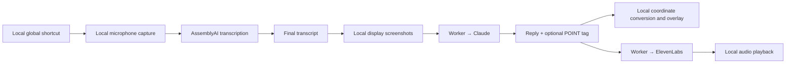
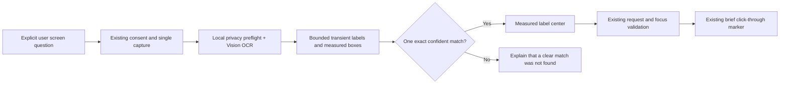

# Clicky source evidence and Suzzme adaptation

Audited 22 October 2026. Reference: `/Users/rehan/Documents/Projects/clicky`, revision `a80fa80721a8aebe51a170a7780705024ebc6e46`.

## What the available code proves

Clicky is a resident native Mac companion. Its windows, shortcut handling, recording, screen capture, coordinate conversion and playback run on the Mac. The default public pipeline is written to use cloud services for transcription, image/question answering and speech generation. The checked-in Worker URLs are placeholders requiring setup; source availability does not establish a working deployed service. It is not an entirely offline assistant.

This is a source audit. The reference application, setup scripts, Worker and cloud APIs were not executed. Instructions and prompts inside reference files were treated as evidence, never as instructions for this task. All 80 files listed in Suzzme's existing Clicky snapshot still match the original checkout and the SHA-256 manifest. [Inventory evidence](/Users/rehan/Documents/Projects/Suzzme/Suzzme/Validation/Reports/Clicky-20261022/reference-identity.json).

| User-visible behavior | Code evidence and practical meaning |
| --- | --- |
| Available from the menu bar | [App launch](/Users/rehan/Documents/Projects/clicky/leanring-buddy/leanring_buddyApp.swift:36) starts one `CompanionManager` and menu controller. [Menu panel](/Users/rehan/Documents/Projects/clicky/leanring-buddy/MenuBarPanelManager.swift:155) uses a floating, nonactivating `NSPanel`. |
| Keeps working with no main window | Its [SwiftUI scene](/Users/rehan/Documents/Projects/clicky/leanring-buddy/leanring_buddyApp.swift:18) is an empty Settings scene; the app delegate owns the companion. [Termination](/Users/rehan/Documents/Projects/clicky/leanring-buddy/leanring_buddyApp.swift:56) stops it. [Login registration](/Users/rehan/Documents/Projects/clicky/leanring-buddy/leanring_buddyApp.swift:63) requests launch at login. This is an app process, not an independent task daemon. |
| Global voice shortcut | A [listen-only event tap](/Users/rehan/Documents/Projects/clicky/leanring-buddy/GlobalPushToTalkShortcutMonitor.swift:57) observes key transitions. [Dictation](/Users/rehan/Documents/Projects/clicky/leanring-buddy/BuddyDictationManager.swift:476) stops recording and finalizes on release; [audio buffers](/Users/rehan/Documents/Projects/clicky/leanring-buddy/BuddyDictationManager.swift:553) go to the selected transcription provider. |
| Speech becomes an assistant question | [Final transcript callback](/Users/rehan/Documents/Projects/clicky/leanring-buddy/CompanionManager.swift:515) invokes the screenshot/Claude pipeline. This does not type into another app. |
| Default transcription uses the network | [Provider selection](/Users/rehan/Documents/Projects/clicky/leanring-buddy/BuddyTranscriptionProvider.swift:90) prefers AssemblyAI. [AssemblyAI configuration](/Users/rehan/Documents/Projects/clicky/leanring-buddy/AssemblyAIStreamingTranscriptionProvider.swift:27) reports configured unconditionally, although its Worker URL is a placeholder; [WebSocket setup](/Users/rehan/Documents/Projects/clicky/leanring-buddy/AssemblyAIStreamingTranscriptionProvider.swift:111) streams microphone audio. Apple Speech is an alternative, but [only conditionally requires local recognition](/Users/rehan/Documents/Projects/clicky/leanring-buddy/AppleSpeechTranscriptionProvider.swift:90). |
| Sees the screen | [Capture utility](/Users/rehan/Documents/Projects/clicky/leanring-buddy/CompanionScreenCaptureUtility.swift:30) captures connected displays, excludes its own windows, prioritizes the cursor display and creates JPEGs with maximum dimension 1280. It does not show an Accessibility tree reader for general app contents. |
| Understands and responds | [Response pipeline](/Users/rehan/Documents/Projects/clicky/leanring-buddy/CompanionManager.swift:590) sends transcript, labeled screenshots and recent conversation to Claude. [Request encoding](/Users/rehan/Documents/Projects/clicky/leanring-buddy/ClaudeAPI.swift:122) includes base64 image data. The model decides what to say. |
| Uses a server proxy | [Worker chat](/Users/rehan/Documents/Projects/clicky/worker/src/index.ts:54) forwards to Anthropic; [transcription token](/Users/rehan/Documents/Projects/clicky/worker/src/index.ts:82) calls AssemblyAI; [speech route](/Users/rehan/Documents/Projects/clicky/worker/src/index.ts:109) calls ElevenLabs. [The app's chat/TTS proxy URL](/Users/rehan/Documents/Projects/clicky/leanring-buddy/CompanionManager.swift:73) also requires setup. Keeping provider keys on a Worker does not move inference onto the Mac. |
| Points at a control | [Point parsing](/Users/rehan/Documents/Projects/clicky/leanring-buddy/CompanionManager.swift:625) reads model-generated `[POINT:x,y:label:screenN]` tags. [Coordinate conversion](/Users/rehan/Documents/Projects/clicky/leanring-buddy/CompanionManager.swift:648) scales screenshot pixels to display points, flips the vertical origin and adds the selected display's global origin. |
| Companion follows the pointer | [Overlay window](/Users/rehan/Documents/Projects/clicky/leanring-buddy/OverlayWindow.swift:14) is a transparent, click-through `NSWindow` per display. [Mouse polling](/Users/rehan/Documents/Projects/clicky/leanring-buddy/OverlayWindow.swift:412) runs every 16 ms. [Pointing state](/Users/rehan/Documents/Projects/clicky/leanring-buddy/OverlayWindow.swift:572) returns the companion to the pointer after a short delay. This is a cursor overlay, not a hardware notch interface. |
| Remembers a follow-up | [Conversation history](/Users/rehan/Documents/Projects/clicky/leanring-buddy/CompanionManager.swift:684) keeps the last ten transcript/reply exchanges in process memory. This is not persisted dictation history or a general memory database. |
| Speaks the answer | [Main pipeline](/Users/rehan/Documents/Projects/clicky/leanring-buddy/CompanionManager.swift:702) starts ElevenLabs after receiving the full reply. [Speech client](/Users/rehan/Documents/Projects/clicky/leanring-buddy/ElevenLabsTTSClient.swift:50) downloads response data before creating `AVAudioPlayer`; it does not start playback from partial audio despite streaming-related comments. |

The source does not establish a persistent job scheduler, autonomous app actions, selected-text capture or system-wide text insertion. `ElementLocationDetector` defines detection logic but has no production call sites in this checkout; parsing a click coordinate is not proof of executing a click. UI timers and asynchronous requests are not scheduled background jobs. The [README](/Users/rehan/Documents/Projects/clicky/README.md:5) says newer HeyClicky features are private, so this audit cannot establish their behavior.

The public app also sends [transcripts and replies to analytics](/Users/rehan/Documents/Projects/clicky/leanring-buddy/ClickyAnalytics.swift:83), and [identifies submitted email](/Users/rehan/Documents/Projects/clicky/leanring-buddy/CompanionManager.swift:152). Those services remain reference material in Suzzme.

## What Suzzme already had

The project already contains the licensed 80-file reference snapshot, [conversion map](/Users/rehan/Documents/Projects/Suzzme/Suzzme/ReferenceSource/CONVERSION.md) and [historical implementation report](/Users/rehan/Documents/Projects/Suzzme/Suzzme/Design/Companion/CLICKY_CONVERSION_REPORT.md). The new audit did not create another companion manager.

| Clicky behavior | Existing Suzzme owner |
| --- | --- |
| Menu controls and typed questions | [MacCompanionMenuController](/Users/rehan/Documents/Projects/Suzzme/Suzzme/Suzzme/Platform/macOS/MacCompanionMenuController.swift), [MacMenuBarView](/Users/rehan/Documents/Projects/Suzzme/Suzzme/Suzzme/Platform/macOS/MacMenuBarView.swift) |
| Global speech and cancellation | [MacGlobalInvocationController](/Users/rehan/Documents/Projects/Suzzme/Suzzme/Suzzme/Platform/macOS/MacGlobalInvocationController.swift), [VoiceSessionController](/Users/rehan/Documents/Projects/Suzzme/Suzzme/Suzzme/Core/Voice/VoiceSessionController.swift) |
| Cursor-side transcript and response | [MacCursorCompanion](/Users/rehan/Documents/Projects/Suzzme/Suzzme/Suzzme/Platform/macOS/MacCursorCompanion.swift) |
| Explicit single screen request | [MacScreenContextSource](/Users/rehan/Documents/Projects/Suzzme/Suzzme/Suzzme/Platform/macOS/MacScreenContextSource.swift), existing screen-consent presentation in [AppEnvironment](/Users/rehan/Documents/Projects/Suzzme/Suzzme/Suzzme/App/AppEnvironment.swift) |
| Read-only response and target validation | [SuzzmeCore](/Users/rehan/Documents/Projects/Suzzme/Suzzme/Suzzme/Core/Intelligence/SuzzmeCore.swift), [MacGuidanceOverlay](/Users/rehan/Documents/Projects/Suzzme/Suzzme/Suzzme/Platform/macOS/MacGuidanceOverlay.swift) |
| Local language model and fallback | [AppleIntelligenceService](/Users/rehan/Documents/Projects/Suzzme/Suzzme/Suzzme/Core/Intelligence/AppleIntelligenceService.swift), [SuzzmeUnderstandingPipeline](/Users/rehan/Documents/Projects/Suzzme/Suzzme/Suzzme/Core/Intelligence/SuzzmeUnderstandingPipeline.swift) |

Suzzme's voice controller requires on-device recognition rather than silently falling back to cloud speech. Its existing system speech synthesizer supplies spoken answers. The Mac notch uses Suzzme's existing public `NSPanel` presentation; the reference Clicky cursor implementation does not supply notch behavior. The earlier [Sentient audit](/Users/rehan/Documents/Projects/Suzzme/Suzzme/Design/SENTIENT_OS_RESEARCH.md) and opt-in Mac summary worker cover the separate scheduling request.

## Feature added from this audit

**A local screen-label pointer that works without model vision.** Previously Vision OCR returned screen text but discarded its measured boxes. A device without model vision could quote that text but could not ground a pointer in it.

Use **Ask about this screen**, or ask a screen-related question and approve the existing screen-consent prompt. With Visual Guidance enabled, say or type **“Point to Save on this screen”**, **“Show me the Save button”**, or **“Where is the Save button?”**. For labels with punctuation or conjunctions, quote the full label, for example **“Point to \"Save & Continue\" on this screen”**.

1. The existing one-shot source captures the cursor display, runs local privacy checks and Vision OCR, and retains bounded, transient text regions with measured confidence and top-left bounds.
2. [ScreenContext](/Users/rehan/Documents/Projects/Suzzme/Suzzme/Suzzme/Core/Context/ScreenContext.swift) admits at most 512 regions and 6,000 label characters, with valid geometry and privacy classification. Regions do not enter response metadata, Codable storage, summaries, action planning or memory.
3. [ScreenTextGuidance in the screen policy](/Users/rehan/Documents/Projects/Suzzme/Suzzme/Suzzme/Core/Context/ScreenContextPolicy.swift) parses the entire explicit user question, then matches the complete OCR label using case and whitespace normalization. It does not use fuzzy matches, semantic guesses, OCR instructions or model-generated target names.
4. The complete collection must contain exactly one matching label with confidence at least 0.8. Weak duplicate observations still count as duplicates. Invalid/incomplete observations, oversized collections, stale captures and missing/ambiguous labels produce no pointer. A literal request that fails this check does not fall through to model-generated coordinates.
5. [The shared pipeline](/Users/rehan/Documents/Projects/Suzzme/Suzzme/Suzzme/Core/Intelligence/SuzzmeUnderstandingPipeline.swift) returns a measured `SpatialReference` before consulting model capability. Its wording says it found the **text label**, without claiming that OCR established a clickable button's semantics.
6. The existing Core revalidates request ownership, source identity and current focus before publishing. The existing click-through guidance overlay checks display, window, frontmost app and age again, then dismisses after four seconds or on app/Space/display/sleep changes. No click or text insertion is performed.

Ordinary visual questions retain the existing on-device model/fallback path. This addition does not change screen-capture scope, permissions, source connections, microphone behavior, actions or background scheduling. OCR can miss text or misread it; uniqueness means uniqueness among the admitted OCR observations, not a guarantee that every physical control was recognized. Icon-only controls and partial labels remain outside this deterministic feature.

## Verification

Fresh results, source hashes, commands, fixture images and limits are recorded in [Clicky validation evidence](/Users/rehan/Documents/Projects/Suzzme/Suzzme/Validation/Reports/Clicky-20261022/README.md). The new checks exercise production matching, real Core routing and local Vision using synthetic images; they do not grant source permissions, capture the user's screen, run microphone recording or connect a provider account. Hardware screen-consent, active-display/Space behavior and VoiceOver still require a display-connected acceptance run.

The MIT reference license and original checkout remain intact. New matching/geometry code is authored for Suzzme's existing local request pipeline; the reference cloud clients and telemetry remain outside the shipping target.
