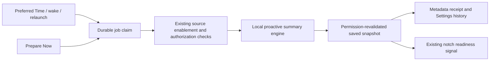

# Sentient OS: source evidence and Suzzme implementation boundaries

Audit date: 22 October 2026. Reference checkout: `/Users/rehan/Documents/Projects/sentient-os`, Git revision `35fd5e8dab8f2a88a5427bc4350d86c582869c90`.

This report describes source control flow, not measured behavior. **The Sentient app, its scripts, model, installers, privileged helper and account integrations were not executed.** No reference files were modified and no personal databases, credentials or account tokens were inspected. The revision identifies the checkout base; a clean working tree is not asserted. Reference documentation and source comments were treated as evidence to compare with implementation, never as instructions for Suzzme.

## What actually runs

Sentient is a native macOS app with a persistent menu-bar surface, a floating notch panel, local ingestion/model work and a separate privileged power helper. User commands and more capable reasoning are routed through a managed CLI and the selected model provider. Local orchestration does not establish that every model response or action runs entirely on the device.

The normal entry is `SentientOSApp.main()`. The same executable branches into root wake-helper mode when launched with `--wake-helper`, before SwiftUI is created. See [main.swift:48](</Users/rehan/Documents/Projects/sentient-os/Sentient OS macOS/App/main.swift:48>). `AppState` owns the command coordinator and scheduler and starts them during app initialization: [AppState.swift:34](</Users/rehan/Documents/Projects/sentient-os/Sentient OS macOS/App/AppState.swift:34>), [AppState.swift:84](</Users/rehan/Documents/Projects/sentient-os/Sentient OS macOS/App/AppState.swift:84>).

The implemented paths are:

```text
User types / uses hotkey / speaks
  → command coordinator → one owned asynchronous command task
  → optional permission-gated screenshots + knowledge context
  → connector router OR managed computer-use/model runtime
  → streamed progress → notch state → confirmed / failed / unconfirmed result

Manual analysis / nightly schedule
  → same selected sources → local extraction + model triage
  → atomic summary + ingestion checkpoint
  → knowledge vault update → optional mirror push
  → decide useful actions → research and prepare cards
  → discard consumed temporary summaries only after success
```

## Background lifecycle and scheduling

| Situation | Evidence-backed behavior |
| --- | --- |
| Home window closes | The process becomes an accessory app and retains its menu-bar anchor. `DockPolicy` changes activation policy; it does not terminate the app. [DockPolicy.swift:39](</Users/rehan/Documents/Projects/sentient-os/Sentient OS macOS/App/DockPolicy.swift:39>), [Sentient_OS_macOSApp.swift:130](</Users/rehan/Documents/Projects/sentient-os/Sentient OS macOS/App/Sentient_OS_macOSApp.swift:130>). |
| App is alive with scheduling enabled | An in-process `Task` calculates the next daily occurrence, asks the helper to arm a wake, waits in five-minute intervals and starts the nightly run. [OvernightScheduler.swift:244](</Users/rehan/Documents/Projects/sentient-os/Sentient OS macOS/Scheduling/OvernightScheduler.swift:244>). |
| Mac sleeps | The app task pauses with the system. The helper has requested a system wake; after waking, the app can continue and request an awake session. This is a wake-and-run design, not computation during sleep. [OvernightScheduler.swift:249](</Users/rehan/Documents/Projects/sentient-os/Sentient OS macOS/Scheduling/OvernightScheduler.swift:249>), [WakeHelper.swift:124](</Users/rehan/Documents/Projects/sentient-os/Sentient OS macOS/Scheduling/WakeHelper.swift:124>). Actual wake/lid behavior was not tested. |
| App quits, crashes or is force-quit | The scheduler is gone. The helper cancels its pending wake when the app's XPC connection invalidates. The helper does not execute the assistant pipeline independently. [WakeHelper.swift:81](</Users/rehan/Documents/Projects/sentient-os/Sentient OS macOS/Scheduling/WakeHelper.swift:81>). |
| User logs in | A registered main-app login item can relaunch the app. Registration and live enabled status use `SMAppService.mainApp`; registration is not a guarantee the user leaves it enabled. [LoginItem.swift:20](</Users/rehan/Documents/Projects/sentient-os/Sentient OS macOS/Scheduling/LoginItem.swift:20>). |

The default scheduled time is **03:00 in the device's current calendar/time zone**. The next occurrence is calculated with `Calendar.current`: [OvernightScheduler.swift:55](</Users/rehan/Documents/Projects/sentient-os/Sentient OS macOS/Scheduling/OvernightScheduler.swift:55>), [OvernightScheduler.swift:542](</Users/rehan/Documents/Projects/sentient-os/Sentient OS macOS/Scheduling/OvernightScheduler.swift:542>). The production scheduler can auto-enable 14 hours after the first successful full cycle, gated on helper availability and login-item state: [OvernightScheduler.swift:58](</Users/rehan/Documents/Projects/sentient-os/Sentient OS macOS/Scheduling/OvernightScheduler.swift:58>), [OvernightScheduler.swift:146](</Users/rehan/Documents/Projects/sentient-os/Sentient OS macOS/Scheduling/OvernightScheduler.swift:146>).

Before processing it checks AC/battery policy, charge, Low Power Mode and critical thermal state: [PowerState.swift:64](</Users/rehan/Documents/Projects/sentient-os/Sentient OS macOS/Scheduling/PowerState.swift:64>). It runs local selected connectors through `IterativeRun(.auto)`, then hosted/connected data legs, then the same `ProactiveCycle` used by manual analysis: [OvernightScheduler.swift:404](</Users/rehan/Documents/Projects/sentient-os/Sentient OS macOS/Scheduling/OvernightScheduler.swift:404>), [OvernightScheduler.swift:427](</Users/rehan/Documents/Projects/sentient-os/Sentient OS macOS/Scheduling/OvernightScheduler.swift:427>), [OvernightScheduler.swift:466](</Users/rehan/Documents/Projects/sentient-os/Sentient OS macOS/Scheduling/OvernightScheduler.swift:466>).

The production helper installer writes a root LaunchDaemon through an administrator authorization dialog: [WakeHelperInstaller.swift:96](</Users/rehan/Documents/Projects/sentient-os/Sentient OS macOS/Scheduling/WakeHelperInstaller.swift:96>), [WakeHelperInstaller.swift:150](</Users/rehan/Documents/Projects/sentient-os/Sentient OS macOS/Scheduling/WakeHelperInstaller.swift:150>). The helper checks its XPC client's signing requirement and operates `pmset`: [WakeHelper.swift:77](</Users/rehan/Documents/Projects/sentient-os/Sentient OS macOS/Scheduling/WakeHelper.swift:77>), [WakeHelper.swift:92](</Users/rehan/Documents/Projects/sentient-os/Sentient OS macOS/Scheduling/WakeHelper.swift:92>). It uses a heartbeat deadman and an absolute six-hour awake ceiling; the scheduler separately cancels a night after 70 minutes without progress: [WakeHelper.swift:154](</Users/rehan/Documents/Projects/sentient-os/Sentient OS macOS/Scheduling/WakeHelper.swift:154>), [WakeHelperProtocol.swift:43](</Users/rehan/Documents/Projects/sentient-os/Sentient OS macOS/Scheduling/WakeHelperProtocol.swift:43>), [OvernightScheduler.swift:280](</Users/rehan/Documents/Projects/sentient-os/Sentient OS macOS/Scheduling/OvernightScheduler.swift:280>).

These safeguards are useful design patterns. The reference's `pmset schedule cancelall` clears system scheduled wake events, and should not be carried into Suzzme: [WakeHelper.swift:142](</Users/rehan/Documents/Projects/sentient-os/Sentient OS macOS/Scheduling/WakeHelper.swift:142>).

## Which intelligence is local

| Path | Actual implementation |
| --- | --- |
| Local document/chat/source triage | `Engine` is an actor around LiteRT-LM. It loads `gemma-4-E4B-it.litertlm` and selects GPU backends for text and vision. [Engine.swift:20](</Users/rehan/Documents/Projects/sentient-os/Sentient OS macOS/Engine/Engine.swift:20>), [Engine.swift:80](</Users/rehan/Documents/Projects/sentient-os/Sentient OS macOS/Engine/Engine.swift:80>), [ModelLocator.swift:17](</Users/rehan/Documents/Projects/sentient-os/Sentient OS macOS/Engine/ModelLocator.swift:17>). |
| Model installation | The model is resolved from the bundle or Application Support; the downloader has a Hugging Face model URL. Local inference still requires acquiring the model first. [ModelLocator.swift:32](</Users/rehan/Documents/Projects/sentient-os/Sentient OS macOS/Engine/ModelLocator.swift:32>), [ModelDownload.swift:44](</Users/rehan/Documents/Projects/sentient-os/Sentient OS macOS/Engine/ModelDownload.swift:44>). |
| Per-item memory | A fresh model conversation is created for each artifact, while the engine is reused for the batch and unloaded afterwards. [Engine.swift:126](</Users/rehan/Documents/Projects/sentient-os/Sentient OS macOS/Engine/Engine.swift:126>), [IterativeRun.swift:404](</Users/rehan/Documents/Projects/sentient-os/Sentient OS macOS/Ingestion/IterativeRun.swift:404>). |
| More capable structured reasoning | The dispatcher chooses Claude CLI or Codex CLI according to the current model backend. A custom endpoint is also supported. [FrontierRun.swift:95](</Users/rehan/Documents/Projects/sentient-os/Sentient OS macOS/Cloud/FrontierRun.swift:95>), [ModelBackend.swift:31](</Users/rehan/Documents/Projects/sentient-os/Sentient OS macOS/Cloud/ModelBackend.swift:31>). |
| Custom local inference | The LM Studio preset points at `127.0.0.1:1234/v1`; OpenRouter is remote. This is an optional provider configuration, not proof every installation uses local reasoning. [ModelBackend.swift:61](</Users/rehan/Documents/Projects/sentient-os/Sentient OS macOS/Cloud/ModelBackend.swift:61>). |
| Computer tasks | The active computer-use backend selects the managed OpenAI native helper. The orchestration starts the helper and streams a managed Codex invocation; Claude selection adds a subscription relay. Low-level helper internals are external to this source path. [ComputerUseBackend.swift:10](</Users/rehan/Documents/Projects/sentient-os/Sentient OS macOS/Driver/ComputerUseBackend.swift:10>), [CodexCLI.swift:746](</Users/rehan/Documents/Projects/sentient-os/Sentient OS macOS/Cloud/CodexCLI.swift:746>). |
| Speech | The fallback recognizer requires on-device recognition only when Apple's recognizer reports support. Therefore the source does not establish fully local transcription on every supported OS/locale. [SFSpeechRecognizerEngine.swift:36](</Users/rehan/Documents/Projects/sentient-os/Sentient OS macOS/Notch Magic/SFSpeechRecognizerEngine.swift:36>). |

The percentage claim in the `ModelBackend` header is not a measured finding of this audit. The verified distinction is local ingestion and orchestration with provider-dependent reasoning and actions.

## How the notch responds

The notch is an ordinary application overlay, not a modification to the physical display cutout. Its controller builds a clear, borderless, nonactivating `NSPanel` above the main-menu level. It joins Spaces/fullscreen and positions a stable canvas at the top center of the selected display: [NotchWindowController.swift:71](</Users/rehan/Documents/Projects/sentient-os/Sentient OS macOS/Notch Magic/NotchWindowController.swift:71>), [NotchWindowController.swift:114](</Users/rehan/Documents/Projects/sentient-os/Sentient OS macOS/Notch Magic/NotchWindowController.swift:114>), [NotchWindowController.swift:223](</Users/rehan/Documents/Projects/sentient-os/Sentient OS macOS/Notch Magic/NotchWindowController.swift:223>).

The coordinator exposes explicit hidden, opening, typing, listening, transcribing, running, finishing and notice phases. Submission trims input, enforces one active run and checks setup/permissions; proactive-card execution adopts that shared run. [CommandCoordinator.swift:27](</Users/rehan/Documents/Projects/sentient-os/Sentient OS macOS/Notch Magic/CommandCoordinator.swift:27>), [CommandCoordinator.swift:134](</Users/rehan/Documents/Projects/sentient-os/Sentient OS macOS/Notch Magic/CommandCoordinator.swift:134>), [CommandCoordinator.swift:201](</Users/rehan/Documents/Projects/sentient-os/Sentient OS macOS/Notch Magic/CommandCoordinator.swift:201>). The panel accepts key status for typing/listening and orders out after the idle transition: [NotchWindowController.swift:182](</Users/rehan/Documents/Projects/sentient-os/Sentient OS macOS/Notch Magic/NotchWindowController.swift:182>), [NotchWindowController.swift:218](</Users/rehan/Documents/Projects/sentient-os/Sentient OS macOS/Notch Magic/NotchWindowController.swift:218>).

`CommandRunModel` owns the asynchronous work, captures optional screenshots, obtains knowledge context, selects connector or computer execution and pushes streamed output into the visible progress model: [CommandRunModel.swift:94](</Users/rehan/Documents/Projects/sentient-os/Sentient OS macOS/Notch Magic/CommandRunModel.swift:94>), [CommandRunModel.swift:147](</Users/rehan/Documents/Projects/sentient-os/Sentient OS macOS/Notch Magic/CommandRunModel.swift:147>). Completion uses a model-output status contract; a zero process exit alone is not counted as success: [CommandRunModel.swift:160](</Users/rehan/Documents/Projects/sentient-os/Sentient OS macOS/Notch Magic/CommandRunModel.swift:160>). This is a software confirmation contract, not independent proof of every external side effect.

The reference also dynamically loads private SkyLight symbols for optional space behavior: [NotchSpace.swift:33](</Users/rehan/Documents/Projects/sentient-os/Sentient OS macOS/Notch Magic/NotchSpace.swift:33>). Suzzme should keep its existing public AppKit panel implementation and adapt its state-driven Face/Presence presentation independently. Private symbols are not necessary to reproduce the core panel-and-state pattern.

## How data enters the response

Source selection is shared between manual and scheduled analysis, including persisted custom folder roots and selected chats: [SourceSelection.swift:19](</Users/rehan/Documents/Projects/sentient-os/Sentient OS macOS/Sources/SourceSelection.swift:19>), [SourceSelection.swift:104](</Users/rehan/Documents/Projects/sentient-os/Sentient OS macOS/Sources/SourceSelection.swift:104>). This is selected-source ingestion, not unrestricted access to every installed app.

| Input | Source mechanism and boundary |
| --- | --- |
| Screen | Screen Recording permission is checked; display images are written temporarily and removed after the command. Image paths are attached to the chosen backend's request. [ScreenCapture.swift:30](</Users/rehan/Documents/Projects/sentient-os/Sentient OS macOS/Notch Magic/ScreenCapture.swift:30>), [CommandRunModel.swift:102](</Users/rehan/Documents/Projects/sentient-os/Sentient OS macOS/Notch Magic/CommandRunModel.swift:102>), [CommandRunModel.swift:147](</Users/rehan/Documents/Projects/sentient-os/Sentient OS macOS/Notch Magic/CommandRunModel.swift:147>). |
| Apple Notes | A temporary SQLite snapshot of the local Notes store is read; locked/deleted notes are excluded by the query. [NotesSource.swift:32](</Users/rehan/Documents/Projects/sentient-os/Sentient OS macOS/Sources/NotesSource.swift:32>), [NotesSource.swift:60](</Users/rehan/Documents/Projects/sentient-os/Sentient OS macOS/Sources/NotesSource.swift:60>). Source selection gates this path on Full Disk Access. |
| Apple Mail | The local Envelope Index is backed up from a read-only SQLite connection and local `.emlx` bodies are resolved. [AppleMailSource.swift:45](</Users/rehan/Documents/Projects/sentient-os/Sentient OS macOS/Sources/AppleMailSource.swift:45>), [AppleMailSource.swift:112](</Users/rehan/Documents/Projects/sentient-os/Sentient OS macOS/Sources/AppleMailSource.swift:112>), [AppleMailSource.swift:236](</Users/rehan/Documents/Projects/sentient-os/Sentient OS macOS/Sources/AppleMailSource.swift:236>). |
| Calendar | EventKit full access is requested, and only selected calendar IDs are gathered. [AppleCalendarSource.swift:25](</Users/rehan/Documents/Projects/sentient-os/Sentient OS macOS/Sources/AppleCalendarSource.swift:25>), [AppleCalendarSource.swift:70](</Users/rehan/Documents/Projects/sentient-os/Sentient OS macOS/Sources/AppleCalendarSource.swift:70>), [AppleCalendarSource.swift:172](</Users/rehan/Documents/Projects/sentient-os/Sentient OS macOS/Sources/AppleCalendarSource.swift:172>). |
| Connected services | Structured runs prepare connected MCP services; user commands prefer an applicable connector path and otherwise fall back to computer execution. [FrontierRun.swift:89](</Users/rehan/Documents/Projects/sentient-os/Sentient OS macOS/Cloud/FrontierRun.swift:89>), [CommandRunModel.swift:114](</Users/rehan/Documents/Projects/sentient-os/Sentient OS macOS/Notch Magic/CommandRunModel.swift:114>). |

Local triage parses structured verdicts, rejects ambiguous or malformed replies, and scans retained titles/summaries for high-risk identifiers: [Triage.swift:44](</Users/rehan/Documents/Projects/sentient-os/Sentient OS macOS/Engine/Triage.swift:44>). Mail/calendar prompts explicitly treat source text as untrusted data: [Triage.swift:115](</Users/rehan/Documents/Projects/sentient-os/Sentient OS macOS/Engine/Triage.swift:115>), [Triage.swift:133](</Users/rehan/Documents/Projects/sentient-os/Sentient OS macOS/Engine/Triage.swift:133>). These are implemented safeguards, not a guarantee that a probabilistic classifier catches all private information.

Survivor summaries become input to knowledge-vault creation/update and proactive reasoning. The optional mirror is pushed after the vault update: [ProactiveCycle.swift:84](</Users/rehan/Documents/Projects/sentient-os/Sentient OS macOS/Proactive/ProactiveCycle.swift:84>), [ProactiveCycle.swift:128](</Users/rehan/Documents/Projects/sentient-os/Sentient OS macOS/Proactive/ProactiveCycle.swift:128>). Accordingly, local extraction does not mean all retained context stays local under every provider/mirror setting.

## Persisted progress, recovery and task completion

Ingestion stores both a source progress record and an optional survivor summary in one SwiftData save. Failed saves roll back; disk-full stops processing rather than advancing an unsaved cursor: [CycleStore.swift:327](</Users/rehan/Documents/Projects/sentient-os/Sentient OS macOS/Ingestion/CycleStore.swift:327>), [IterativeRun.swift:374](</Users/rehan/Documents/Projects/sentient-os/Sentient OS macOS/Ingestion/IterativeRun.swift:374>). Initial scans persist a descending floor; incremental scans advance the high-water mark. An interrupted automatic run selects the appropriate resume mode and excludes already processed items: [CycleStore.swift:380](</Users/rehan/Documents/Projects/sentient-os/Sentient OS macOS/Ingestion/CycleStore.swift:380>), [CycleStore.swift:445](</Users/rehan/Documents/Projects/sentient-os/Sentient OS macOS/Ingestion/CycleStore.swift:445>), [IterativeRun.swift:274](</Users/rehan/Documents/Projects/sentient-os/Sentient OS macOS/Ingestion/IterativeRun.swift:274>).

The database is persisted as `IterativeCycle.store` under Application Support. An open/migration failure preserves the existing data rather than deleting it: [CycleStore.swift:549](</Users/rehan/Documents/Projects/sentient-os/Sentient OS macOS/Ingestion/CycleStore.swift:549>). This establishes resumable ingestion; it does not establish exactly-once execution for all external actions.

The shared proactive tail updates the vault, decides actions, researches/prepares cards, then wipes only consumed transient summaries after success. Failures retain summaries for retry: [ProactiveCycle.swift:128](</Users/rehan/Documents/Projects/sentient-os/Sentient OS macOS/Proactive/ProactiveCycle.swift:128>), [ProactiveCycle.swift:170](</Users/rehan/Documents/Projects/sentient-os/Sentient OS macOS/Proactive/ProactiveCycle.swift:170>), [ProactiveCycle.swift:207](</Users/rehan/Documents/Projects/sentient-os/Sentient OS macOS/Proactive/ProactiveCycle.swift:207>). A nightly analysis therefore prepares useful work; it should not be described as an unrestricted durable scheduler that executes every proposed action. Some source headers still describe scheduler integration as future work, but the scheduler's actual call to the shared pipeline is present.

The reference's computer command arguments bypass CLI approval and sandbox boundaries: [CodexCLI.swift:693](</Users/rehan/Documents/Projects/sentient-os/Sentient OS macOS/Cloud/CodexCLI.swift:693>). This is an observed reference implementation choice. Suzzme's task implementation should continue to use its own existing permission and action-confirmation system; the reference is not authorization to weaken it.

## Implemented in Suzzme

Suzzme now has an independently authored **scheduled local Daily Summary worker**. It is opt-in at **Settings → Daily Summary & Suggestions → Background on This Mac** and uses the existing Preferred Time. Prepare Now and automatic preparation share the same serialized runner. This implementation covers source refresh and summaries; it does not add arbitrary computer-use automation or delayed write approval.



| Behavior | Implementation evidence |
| --- | --- |
| Serialized automatic/manual execution, one-shot deadline, bounded busy retries, cancellation and late-result rejection | [ScheduledBriefingEngine.swift:6](/Users/rehan/Documents/Projects/Suzzme/Suzzme/Suzzme/Core/Background/ScheduledBriefingEngine.swift:6) |
| Default-off setting, atomic claim before work, interrupted recovery, local-day/schedule deduplication and at most 32 metadata receipts | [ScheduledBriefingStore.swift:49](/Users/rehan/Documents/Projects/Suzzme/Suzzme/Suzzme/Core/Background/ScheduledBriefingStore.swift:49) |
| Refresh through existing InformationEngine; use already-permitted Calendar/Reminders and saved local items; final permission revalidation before publication | [AppEnvironment.swift:935](/Users/rehan/Documents/Projects/Suzzme/Suzzme/Suzzme/App/AppEnvironment.swift:935) |
| Scheduled summaries bypass interactive session-memory projection while ordinary interactive summaries retain it | [SuzzmeCore.swift:501](/Users/rehan/Documents/Projects/Suzzme/Suzzme/Suzzme/Core/Intelligence/SuzzmeCore.swift:501) |
| App-lifetime ownership, independent sleep/session gating, wake/clock/timezone reconciliation, teardown and draining | [MacScheduledBriefingController.swift:7](/Users/rehan/Documents/Projects/Suzzme/Suzzme/Suzzme/Platform/macOS/MacScheduledBriefingController.swift:7) |
| Completion gets a fresh identity on the existing notch; active conversations and voice retain presentation priority | [MacGlobalInvocationController.swift:257](/Users/rehan/Documents/Projects/Suzzme/Suzzme/Suzzme/Platform/macOS/MacGlobalInvocationController.swift:257) |
| Native opt-in, next preparation, progress/stop and summary navigation | [ScheduledBriefingSettingsSection.swift:4](/Users/rehan/Documents/Projects/Suzzme/Suzzme/Suzzme/Features/Settings/ScheduledBriefingSettingsSection.swift:4) |
| App-owned task status, effective setting, stopping transition, bounded metadata history and truthful retry display | [BackgroundTasksView.swift:6](/Users/rehan/Documents/Projects/Suzzme/Suzzme/Suzzme/Features/Background/BackgroundTasksView.swift:6) |

The Mac must remain awake and Suzzme must remain running. Closing Home does not stop the worker; quitting does. Wake/relaunch checks only today's missed slot, with bounded retries, rather than replaying an unbounded backlog. There is no privileged helper, forced wake, login registration, private SkyLight integration, new model download, microphone/screen capture, or action execution in this feature. Connected source reads may require network access; summary processing stays local. iPhone keeps its existing system background limitations.

Receipts contain dates, status, counts and a summary ID, not copied source bodies or response text. Turning automatic preparation off cancels owned work; Reset Proactive Data also turns it off. Clearing summaries cancels the current run and clears its ready notice. Existing source consent, permission revalidation, source provenance and action-confirmation boundaries remain authoritative.

Validation: **31 scheduler checks, 45 exact AppEnvironment-boundary checks and 17 actual Mac-adapter lifecycle checks pass**. The existing actual-Core suite passes **52 checks**, including four new assertions proving scheduled memory isolation and retained interactive behavior. Existing memory/voice/action baselines remain at 53/90/198 passes. Detailed build results, regression logs, light/dark native component previews and their limits are in the [implementation validation report](../Validation/Reports/Sentient-20261022/README.md). The previews use an isolated metadata fixture; they are not live-account or physical-notch acceptance.

## License and implementation provenance

The reference repository's root [LICENSE:1](</Users/rehan/Documents/Projects/sentient-os/LICENSE:1>) identifies the **GNU Affero General Public License, version 3**. This is factual license attribution, not a legal determination about a particular distribution. Third-party/vendor components can have their own licenses.

The intended Suzzme implementation is independently authored around Suzzme's existing architecture. This report records behaviors and design patterns; it does not transplant Sentient source, prompts, assets, private API integrations, privileged installation code or bundled runtimes. Any later decision to incorporate reference code would require a separate license review.
