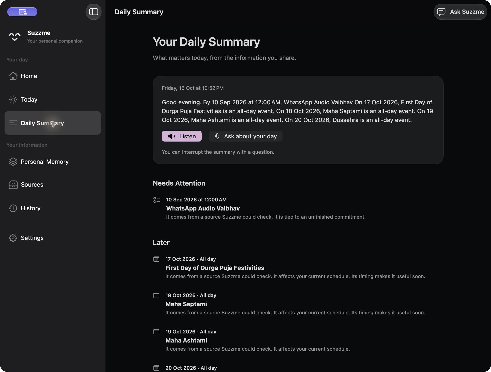
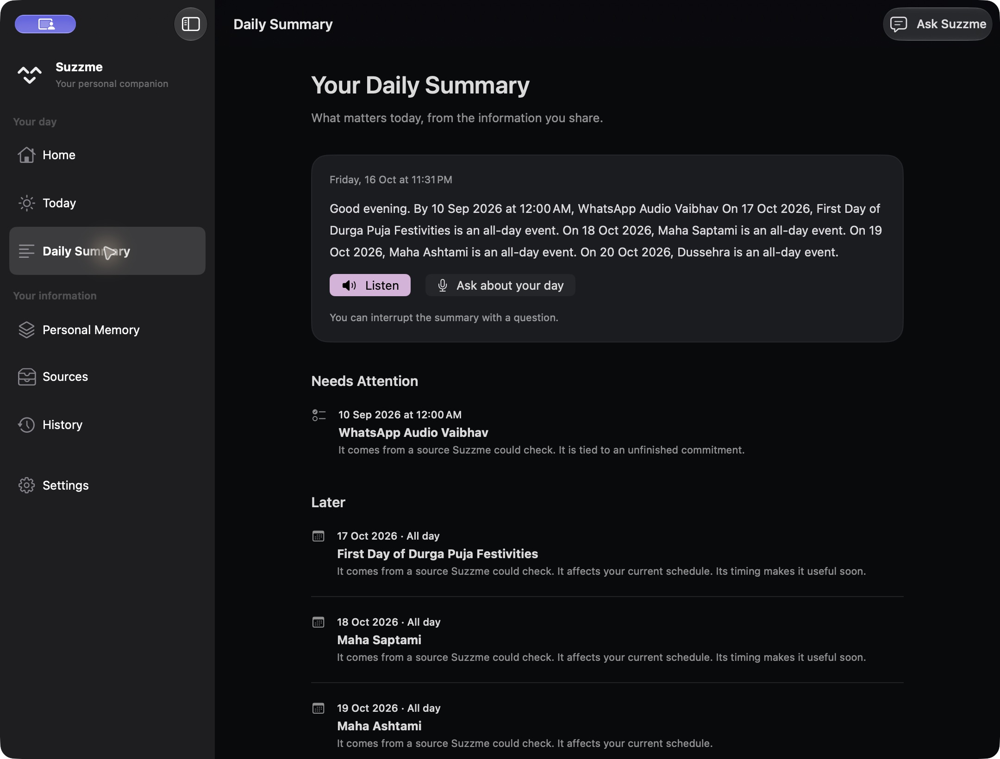
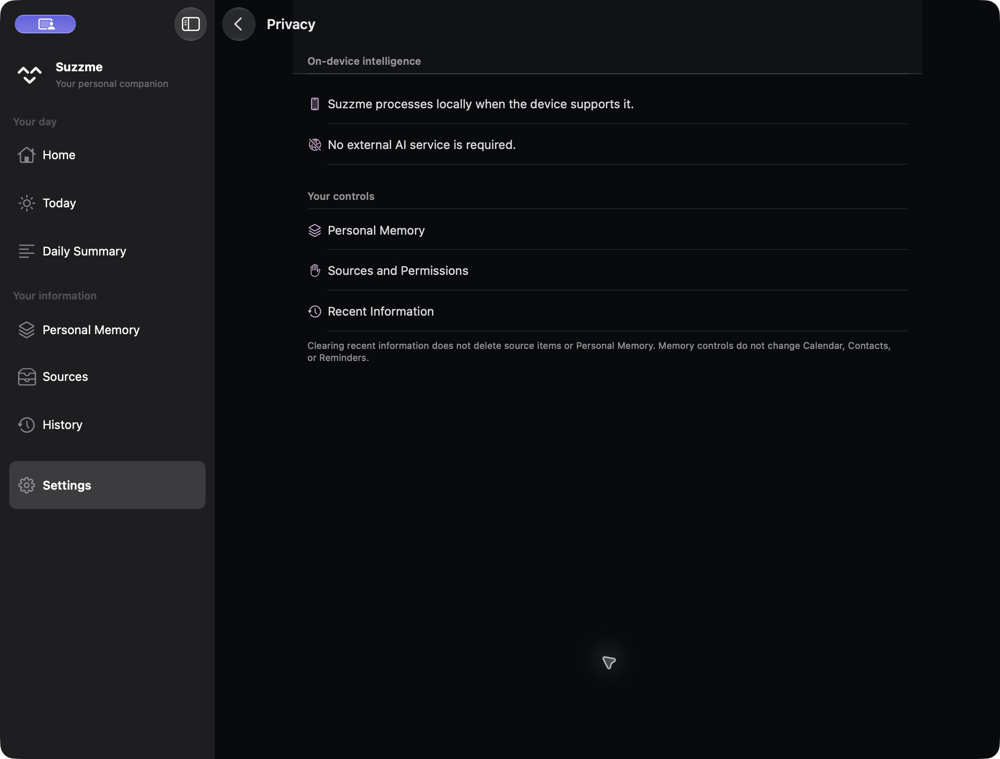
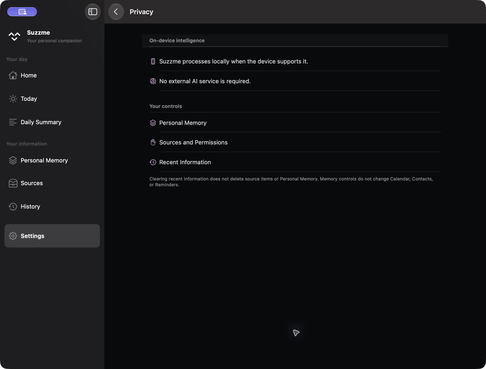
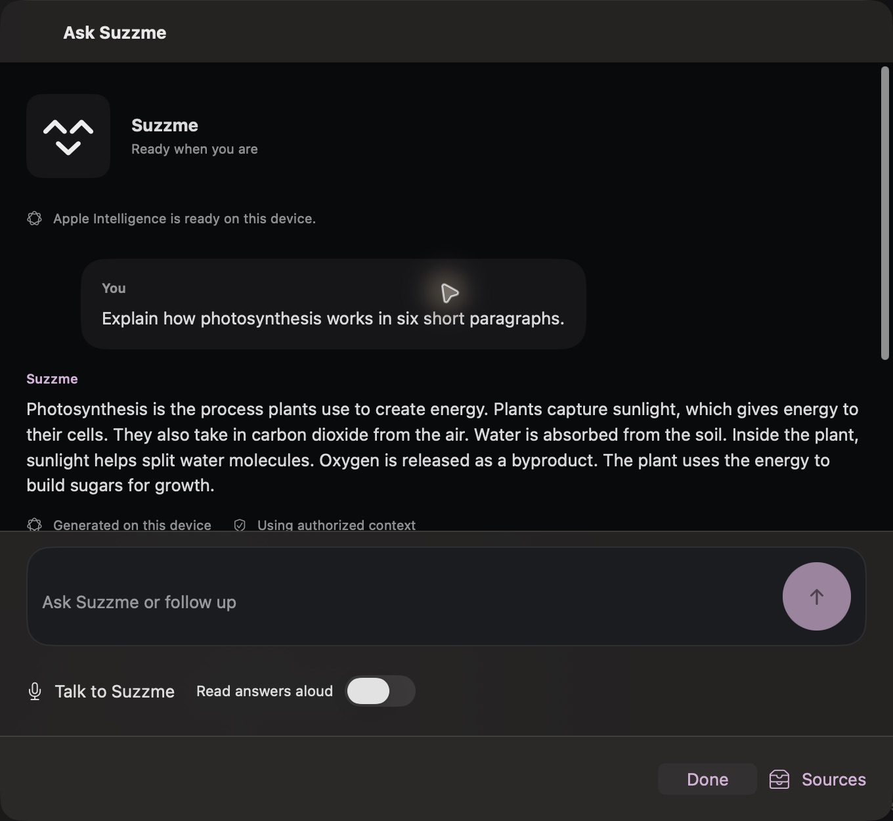
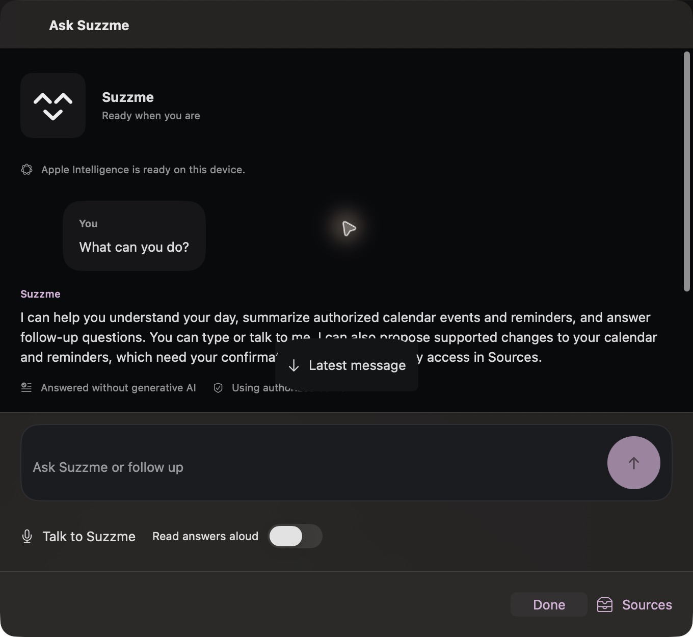
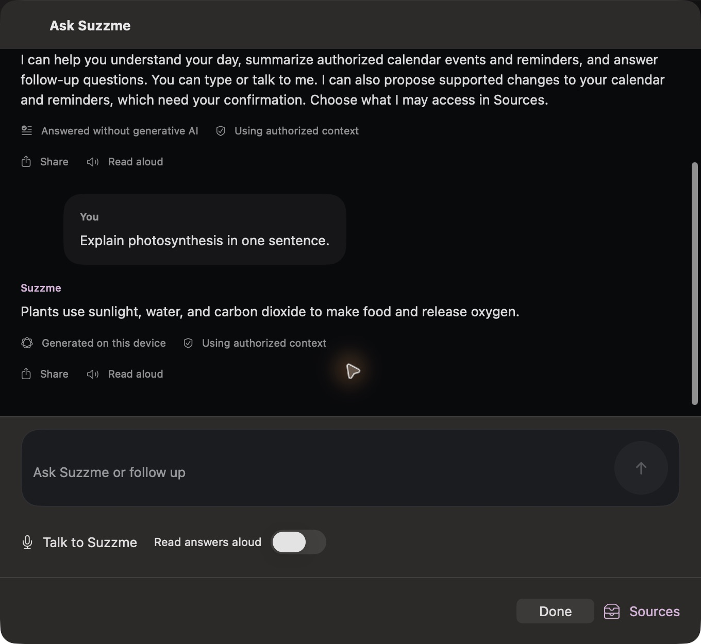

# Step 19 before / after

All images here are actual native production Mac captures. Content and preparation timestamps can differ because the app reads its real local stores. Screenshots are private local evidence.

## Daily Summary

The same narration remains unsegmented and selectable; line spacing, reading measure and separators between dated items improve scanning. This does not claim a rewrite of the generated summary.

Before:

After:

## Shared native list spacing

The Privacy section now has the same 24-point top rhythm as page-based content.

Before:

After:

## Conversation position

The first production attempt used existing lifecycle tracking. Scrolling upward left Latest message hidden. Conversations differ between captures; compare the return control and viewport position.

Before correction (rejected intermediate capture):

After correction, reading earlier turns:

After clicking Latest message, the final turn is visible, the scrollbar reaches 1 and the return control disappears:

## Appearance and compact layout

[All 33 final native captures and intermediate evidence](screenshots.html) include every main Mac route at a compact window size, regular restored layouts, light/dark Home, Assistant, Daily Summary, Voice, Presence and Integrations. Presence Settings explicitly contains a Live preview; it is not physical-notch acceptance. The captured compact size is approximately 736 × 553 points, not a claim that every minimum/maximum size was tested.

No accepted iOS screenshot is available. See [iOS startup diagnosis](IOS-STARTUP.md).
