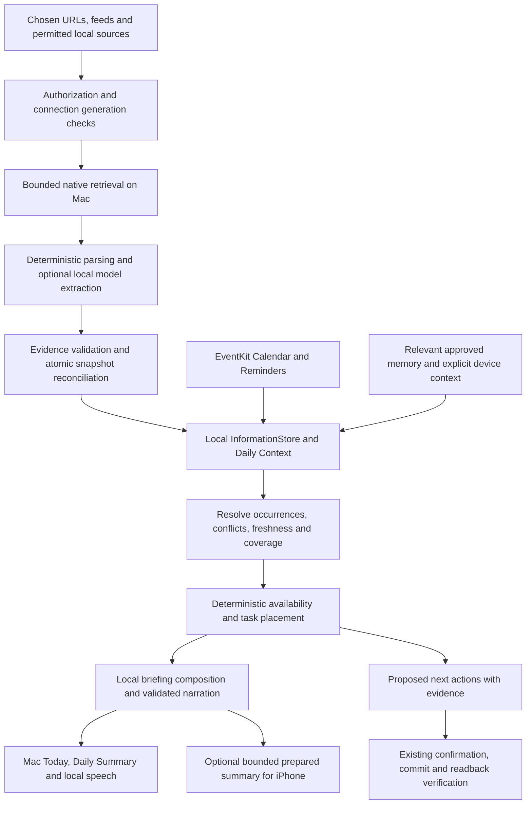

# Sentient OS architecture adoption for Suzzme

Review and implementation proposal, 10 November 2026.

Status: architecture draft. This review changes no application behavior, enables no network transport, and imports no Sentient OS source. The requested deliverables are comprehension, a custom URL connector strategy, and an on-device schedule synthesis pipeline. Implementation phases below describe subsequent engineering work.

## 1. Product understanding and evidence

I reviewed all 19 pages of the **Suzzme Full Product Report**, dated 4 November 2026, and inspected the relevant ingestion, inference, connector, knowledge, and proactive code in the supplied Sentient OS checkout. I also traced Suzzme's current source-to-briefing path at commit `f18be88`. Sentient was supplied as a directory without a top-level Git checkout, so no upstream commit identity is asserted.

Suzzme's intended role is a Mac-first personal assistant: gather explicitly authorized context, explain today's commitments and meaningful changes, propose useful next steps, and answer follow-up questions. The iPhone presents a bounded prepared result. Source permission, inclusion in Daily Summary, durable Personal Memory, action authorization, and optional sharing remain separate controls. The report's recommendations are source material for this review, not additional instructions to execute migrations, connect accounts, or publish anything.

The report distinguishes implemented, verified, deployed, and accepted. This proposal preserves that distinction: inspected source is evidence of a code path, not proof of real-account operation, hardware performance, or release readiness. The report records outstanding provider, signing, physical-device, and companion-transfer acceptance; those were not rerun here. Its Gmail table is a simplified snapshot: the current composition also includes an explicitly authorized body-summary path, documented in the existing knowledge-source architecture note.

## 2. What to adopt from Sentient

| Mechanism observed in Sentient | Evidence | Application to Suzzme |
| --- | --- | --- |
| Thin adapters list bounded work and load an individual artifact; the coordinator owns traversal | `Ingestion/Connector.swift`, `IterativeRun.swift` | Keep adapters focused on retrieval; centralize retries, budgets, cancellation, and checkpoint ownership. |
| One local engine per batch, fresh conversation per item, bounded context and output, GPU recovery | `Engine/Engine.swift` | Reuse a local inference owner without carrying one source's conversation into another. Benchmark recovery settings for Suzzme rather than copying tuning constants. |
| Local triage and privacy checks before retaining useful summaries | `Engine/Triage.swift`, `PIIScan.swift` | Retain grounded evidence and useful structured facts; uncertain model output cannot establish a commitment or permission. Pattern checks supplement, rather than guarantee, privacy. |
| Summary and progress advance together | `Ingestion/CycleStore.swift` | Atomically commit accepted facts and the source checkpoint. A crash cannot advance progress past unsaved facts. |
| Mutable calendars use complete, validated snapshots | `Sources/AppleCalendarSource.swift`, `CycleStore.commitCalendarSnapshot` | Timetables and calendars need replacement/reconciliation semantics. An append-only watermark misses moved and deleted occurrences. |
| Human-readable Markdown knowledge is staged and atomically published | `Vault/VaultGenerator.swift`, `VaultCloud.swift` | Preserve inspectability and atomic publication. Suzzme's existing stores remain authoritative; an optional Markdown export can be derived from them. |
| OAuth account identity, Keychain grants, connection generations, and disconnect cancellation | `Connectors/DirectMCP*` | Separate authentication from content readiness; bind retrieved facts to the actual source/account generation. |
| Decide and prepare are separate from execution | `Proactive/ProactiveCycle.swift`, `ProactiveResearch.swift` | Automatically suggest actions locally; confirmed mutations continue through Suzzme's existing typed action boundary. |

**Important difference:** Sentient's on-device first pass is not an all-local guarantee. `ProactiveCycle` sends useful summaries into the selected frontier workflow; `VaultGenerator` dispatches through `FrontierRun`. Its documentation explicitly permits hosted inference for knowledge consolidation and proactive work. Direct MCP credentials being in Keychain does not make the selected inference local. Suzzme must implement consolidation, extraction, summarization, and planning through local-only services to meet this request.

The inspected Sentient source kinds and adapters do not establish a general “paste any website URL” timetable connector. Its supported remote MCP services are a separate mechanism: a website URL is not automatically an MCP endpoint. Custom site ingestion is additional Suzzme engineering.

Sentient's `LICENSING.md` declares AGPL-3.0 and describes a commercial licensing option; Suzzme's README declares proprietary licensing. This draft uses Sentient as an architectural reference and copies no implementation. Resolve the intended reuse terms before importing its application code or vendored modifications. Runtime and model asset licenses also need their own inventory.

## 3. Extend Suzzme's existing architecture

The existing path already provides most of the integration spine:

```text
InformationSource adapters
  -> InformationEngine: authorization, refresh ownership, revalidation
  -> InformationStore: normalization, deduplication, versions, retention
  -> ProactiveIntelligenceEngine: relevance, Daily Context, briefing
  -> SuzzmeCore / native presentation / optional companion result
```

Keep this path. Add per-connection metadata and richer schedule evidence instead of introducing a competing knowledge store or replacing SuzzmeCore with Sentient's CLI orchestration.

Current constraints requiring work:

- **Watched Links is disabled in production.** The compile gate `SUZZME_PINNED_WATCHED_TRANSPORT` is absent from the app project. The existing DNS-SD resolver does not prove a complete initial A/AAAA answer set, required by the current mixed-address rejection contract. Keep the gate closed until that requirement is established with an appropriate resolver and connection acceptance evidence; ordinary URLSession fetching is not a substitute for this contract.
- **Current extraction is heuristic.** `WebContentExtractor` strips HTML and identifies times, deadlines, cancellations, and rooms from text segments. It does not implement general DOM tables, iCalendar recurrence, JSON-LD events, or authenticated portals.
- **Current source grouping is broad.** `InformationSourceRegistry` is keyed by `InformationSourceID`, with one `.watchedWeb` adapter. Add connection-level identity, health, cursor, and coverage beneath that adapter, or evolve the registry compatibly. One broken URL must not prevent healthy URLs from committing useful results.
- **Local Knowledge is an import library.** Its information adapter emits newly analyzed excerpts for the current day; that import timestamp is not an event's scheduled time. A document imported yesterday can contain tomorrow's class. Structured occurrence extraction must preserve those separate dates.
- **Planning needs stronger evidence.** `DayPlannerEngine` currently assumes one hour when an end is absent and calculates gaps without a source coverage contract. It also needs interval clipping to the planning horizon, all-day busy policy, travel/break buffers, and explicit handling of unknown end times. A missing calendar is not evidence of a free day.
- **Narration needs factual validation.** `locallySummarized` currently checks size and privacy of the generated narration. Extend this with structured fact references and deterministic rendering of factual names, times, status, and locations; fluency checks alone cannot establish faithfulness.

## 4. Custom URL connector strategy

### Connection flow

Sources -> Add Website -> enter URL -> inspect source type and access needed -> select the relevant page/feed/course -> preview extracted facts and limitations -> enable refresh and Daily Summary inclusion separately.

Show the actual authorization state, last successful check, coverage, source time zone, next eligible refresh, and why a source needs attention. A successful login must not be displayed as a successfully read timetable. A detected timetable is not automatically the user's timetable: require the selected student/course/section where applicable.

### Retrieval paths

| Source type | Retrieval and parsing | Boundary |
| --- | --- | --- |
| Public personal site or college notice page | Existing bounded HTTPS transport after its gate is satisfied; static HTML/text, then supported structured formats | Anonymous read of explicitly selected URLs; no unrestricted crawl or JavaScript execution. |
| Published calendar or task feed | Explicitly selected ICS feed, including `VEVENT` and supported `VTODO` fields | New MIME/parser support is required. Parse recurrence and exceptions within a bounded horizon; do not auto-fetch attachment URLs. Treat secret feed URLs as credentials. |
| Structured website | JSON-LD `Event`/supported task schema, semantic HTML tables and `time` elements | Parse allowlisted JSON data blocks without executing script. Preserve table row/column relationships and source offsets. |
| Authenticated college portal with supported API | User-authorized read-only provider adapter; native OAuth/PKCE where supported | Store grants in Keychain, select the relevant course resources, retrieve on the Mac, then infer locally. No remote AI connector is required. |
| Portal with only a browser UI | Explicitly shared page/export initially; later, a separately consented browser adapter scoped to selected origins/pages | Session-bound access must be designed and accepted separately. A shared snapshot is not automatic background sync. No extraction of existing browser cookies or credential prompts from page text. |
| Supported MCP service | Native client restricted to reviewed reads, with bounded results and explicit server/account identity | MCP is optional. Remote servers receive their requests; returned content is parsed and reasoned over locally. Tool annotations alone do not authorize arbitrary tools. |

If a site depends on login, CAPTCHA, unsupported scripts, or an unimplemented schema, explain the limitation and offer a selected export/feed where available. Adding a URL cannot promise universal portal access. Authenticated browser transport must receive its own security design; it cannot silently inherit the anonymous fetcher's safety claims.

### Extraction and grounding

1. Validate the selected URL and fetch with resource limits. Revalidate each redirect and destination. Public requests carry no cookies, credentials, referrer, or model context.
2. Detect supported content deterministically. Prefer provider API/ICS identifiers, then JSON-LD/semantic tables, then readable text. Use local OCR/PDF extraction only for explicitly supported bounded documents in a later phase.
3. Pass bounded, sanitized sections to the on-device model when deterministic parsing is insufficient. Request typed candidates with exact source excerpts; do not expose browser, network, action, or file-writing tools to the model.
4. Validate every candidate in Swift: excerpt exists in the captured source, date/time interpretation is supported, end follows start, required time zone is known, status is valid, and identity is bound to the selected scope. Model confidence is a hint, not proof.
5. Preserve unresolved items as tentative information. “Class at 10” without a resolvable date or time zone cannot become a confirmed calendar block. Offer one source-level time-zone setting when the site omits it; disclose that assumption.
6. Preview the first extraction and any scope changes. Routine updates within the approved scope can refresh automatically; creating a reminder or calendar event still requires the action flow.

### Proposed local records

These are schema proposals, not existing Swift types:

```text
KnowledgeConnection
  id, canonicalURL or secretURLKeyReference, sourceType, selectedScope
  accountIdentity?, consentRevision, connectionGeneration
  inclusionPreferences, sourceTimeZone, refreshPolicy, health

SourceSnapshot
  connectionID, generation, capturedAt, contentFingerprint
  parserVersion, ETag?, LastModified?, boundedEvidence
  coverage { scope, interval, complete, truncations, omissions }

ScheduleFact
  id, connectionID, generation, sourceObjectID, occurrenceID
  kind { event, task, deadline, cancellation, locationChange }
  title, start?, end?, due?, timeZone?, allDay?, status
  datePrecision, attribution, recurrenceIdentity?, supersedes?
  evidence { snapshotID, excerpt, sectionOrRow, sourceURLReference }
```

Use opaque connection/object identifiers in `InformationObservation.externalID`; raw long URLs and secret query strings do not belong in evidence IDs or logs. Retain a bounded local evidence record rather than unbounded HTML. Keep credentials and private feed URLs out of model prompts and companion payloads.

### Refresh and reconciliation

Preserve existing starting limits: 12 selected pages, at least 15 minutes between refresh attempts, 15 seconds per fetch, three redirects, 512 KiB response bodies, 24,000 extracted characters, and 30-day change retention. Add per-run/model token budgets and provider backoff; any new format requiring larger limits gets an explicit review.

Use ETag/Last-Modified and content fingerprints to skip repeated extraction. A 304 revalidates a retained snapshot; it does not establish a new event time or broaden coverage. In particular, do not reinterpret unchanged text saying “tomorrow” against a later fetch date. Retain the original reference date, or mark relative-date ambiguity until new dated evidence exists.

Use append-only cursors only where the source guarantees append-only records. Reread mutable timetable windows, compare stable occurrence identities, and publish a replacement atomically. An ICS key can combine UID with RECURRENCE-ID; for HTML, use source identifiers or a reviewed row identity. Do not merge unrelated classes by title alone, or use the current time/location as an object's identity.

A complete successful snapshot of the same scope/window can establish absence. Partial pagination, truncation, a model omitting a fact, authentication failure, or an unreadable page cannot. “No longer present” also does not establish that an event was attended or completed. Explicit cancellation and location-change notices must target a known occurrence; unmatched notices remain unresolved.

Commit facts, fingerprint, coverage, and cursor under one durable ownership transaction. The current watched JSON store and information SwiftData store are distinct persistence boundaries: either consolidate new authoritative records into one transaction or add a durable replay receipt with idempotent delivery. Sequential saves to two stores must not be described as atomic. On disconnect/removal, retire the generation, cancel work, remove derived eligibility, and invalidate cached briefings and proposals. Late responses cannot restore revoked data. Legacy records lacking new provenance require a fresh reviewed read.

## 5. On-device daily synthesis pipeline



1. **Capture preparation scope.** Freeze the local day/time zone, current instant, planning horizon, user inclusion settings, and connection generations. Refresh near the preferred briefing time and on relevant source changes with debounce. Use the existing serialized manual/scheduled worker.
2. **Collect bounded current context.** Read authorized EventKit events/reminders plus selected website facts, messages, documents, and provider resources. Record permission failures and incomplete ranges. Device context means permitted data and explicitly requested screen context, not continuous tracking.
3. **Reconcile identity and authority.** Merge genuine duplicates using shared stable identifiers and matching occurrences. EventKit owns the actual native calendar state; a current portal notice may report that its copied class is stale. Preserve and explain that disagreement rather than silently changing EventKit or applying a universal “newest source wins” rule.
4. **Build Daily Context.** Include commitments, cancellations, completed tasks, changes, deadlines, and relevant durable preferences. Separate source update time, observation time, effective event time, and completion evidence. Retrieve future commitments by effective time rather than their import date. Use deterministic date/entity filtering first; an embedding index is optional and must remain local.
5. **Calculate availability.** Clip busy intervals to the chosen day/horizon, expand recurring occurrences and exceptions, merge overlaps, apply user working hours and known buffers, and subtract them from the planning range. Respect all-day busy status. Unknown event ends, missing selected sources, stale snapshots, or truncated coverage weaken availability claims. Say “no commitments found in the checked sources” when coverage is partial.
6. **Place suggested work.** Rank by explicit deadline, urgency, dependency, user preference, and estimated duration. Fit tasks into valid gaps without double booking or repeatedly allocating the same task. Mark estimated durations and preparation/travel buffers as assumptions. Leave work unscheduled when no safe slot fits; explain a conflict rather than fabricate a solution. Extend the planning horizon for future deadlines when requested.
7. **Compose the briefing locally.** Produce a typed briefing containing greeting, ordered facts, changes, proposed blocks, evidence references, freshness, and limitations. The model can organize and phrase supported content. Swift renders factual slots and rejects unknown references or altered dates/status. Fall back to deterministic narration on model unavailability or invalid output.
8. **Publish and suggest.** Save one consistent local snapshot. Present facts separately from suggestions, with a source and “last checked” detail. Recheck authorization/freshness before display and action commit. Creating events/reminders uses the existing action plan, exact confirmation, idempotent execution, and verified readback.

Illustrative output, assuming the listed source facts and coverage exist:

> Hey Rehan, your Algorithms class is at 10:00 AM in Lab 2, followed by Physics at 11:30 AM. Your checked schedule has a gap from 12:30 to 2:00 PM. I suggest using 45 minutes of that gap for the assignment due tomorrow. The college notice moved Algorithms from Room 4 to Lab 2. I checked the timetable at 8:00 AM.

If the portal could not refresh:

> Hey Rehan, Calendar shows Algorithms at 10:00 AM. I couldn't check your college portal, so its room and any timetable changes remain unverified. I can suggest time around your checked Calendar events, but other commitments may be missing.

The times and course names above are synthetic examples, not observations about the user's real day.

## 6. Local inference and data protection

Keep Apple Foundation Models as the first implementation backend on eligible Macs, using Suzzme's existing availability checks. Guided generation supports typed output; it does not independently prove factual accuracy. Apple's [Foundation Models generation guide](https://developer.apple.com/documentation/FoundationModels/generating-content-and-performing-tasks-with-foundation-models) documents on-device generation and typed output.

For Macs without an available system model, retain deterministic parsing, scheduling, and template briefings. Add a separately packaged in-process model backend if broader generative capability is required. LiteRT-LM is a relevant candidate: its [official Swift API](https://developers.google.com/edge/litert-lm/swift) supports native macOS and Metal. The supplied Sentient checkout uses a customized, pinned v0.13.1 wrapper with Gemma 4 E4B; this is a reference configuration, not a measured compatibility/performance result for Suzzme. Choose and pin a runtime/model after target-Mac memory, quality, license, cancellation, and thermal tests.

All extraction, triage, consolidation, ranking, planning, and narration must use an in-process local backend or deterministic Swift. Do not offer a silent hosted fallback. Website retrieval still communicates with the selected website; source access and AI inference are separate network boundaries. Downloads fetch model assets without attaching personal context.

Credentials remain in Keychain. Minimize retained evidence, restrict app-owned storage, redact content from diagnostics, and explicitly decide backup inclusion. If application-level encryption is required for new retained evidence, implement authenticated encryption with a Keychain-managed key and test key-loss/deletion behavior; SwiftData alone is not evidence of application-level encryption.

Keep source facts separate from long-term Personal Memory. A class notice does not automatically become durable memory. Optional iPhone sharing sends the prepared summary through the existing account boundary and remains an explicit disclosure; this draft makes no new end-to-end encryption claim. A strict local-only experience also uses local speech paths and excludes optional cloud voice. Validate that personal prompts, facts, screenshots, audio, and briefings do not enter telemetry or remote inference routes.

## 7. Implementation sequence and ownership

| Phase | Main integration points | Completion condition |
| --- | --- | --- |
| 1. Per-connection evidence and reconciliation | `Core/Information/InformationModels.swift`, `InformationEngine.swift`, `InformationStore.swift`, `WatchedLinkModels.swift`, `WatchedLinkStore.swift` | Versioned connection scope, migration, coverage, generation ownership, and crash-safe commit/replay; healthy sources survive another source's failure. |
| 2. Safe public URL intake | `WebURLPolicy.swift`, `WatchedWebSource.swift`, `Packages/SuzzmeWatchedTransport`, existing validation scripts | DNS completeness requirement and connection contract demonstrated before enabling the transport; real signed-Mac public-page acceptance. |
| 3. Structured source extraction | `WebContentExtractor.swift`, new bounded ICS/JSON-LD/table parsers, local intelligence service | Preview accurately shows recurring class, deadline, room change, cancellation, and unresolved ambiguity with evidence. |
| 4. Grounded schedule and briefing | `DayPlannerEngine.swift`, `Core/Proactive/ProactiveIntelligenceEngine.swift`, `Core/Intelligence`, `Core/Background` | One consistent plan with clipped intervals, coverage-aware availability, future deadlines, truthful narration, and useful deterministic fallback. |
| 5. Authenticated portal adapter | Source selection, native read-only auth/API adapter, Keychain; optional browser bridge only if needed | A selected real portal completes connect/read/expiry/reconnect/revoke acceptance without remote inference. |
| 6. Presentation and companion acceptance | `AppEnvironment.swift`, Sources, Briefing, existing action boundary and companion transport | Inspectable evidence, complete disconnect cleanup, confirmed actions, and opt-in same-account prepared-summary transfer. |

Start with a supplied public timetable/ICS fixture and one explicitly selected real source when available. No real college portal, login, or timetable URL was supplied, so authenticated compatibility remains unassessed. The public transport blocker can be worked on independently of local parser/planner fixtures.

## 8. Acceptance scenarios

These are proposed acceptance checks, not tests executed during this review:

- A public timetable plus Calendar and Reminders produces a briefing with the exact evidenced class time, room, assignment deadline, and source timestamps.
- An overnight room/time change replaces the old occurrence. A cancellation removes its busy interval only when cancellation identity is supported. An event deleted from a complete snapshot differs from an event absent from a partial response.
- ICS recurrence exceptions, ambiguous numeric dates, time-zone travel, daylight-saving transitions, all-day busy events, overnight events, missing end times, and conflicts are handled explicitly.
- Unknown portal coverage never yields a definitive free-time claim. No proposal crosses the planning horizon or collides with a busy interval/buffer; no task is silently duplicated.
- Identical responses and 304s produce no duplicate facts, and unchanged relative-date text does not move a deadline forward every day.
- Crash/relaunch between persistence stages safely replays pending facts. Disconnect, scope change, and account switch reject late work and invalidate derived eligibility.
- Malicious page instructions, hidden scripts, secret feed URLs, credential-bearing redirects, unsafe/mixed DNS answers, and oversized responses cannot acquire action authority or escape retrieval limits.
- After authorized content/model download, disable external network access: cached/current local facts still support local synthesis; unrefreshable websites are marked stale. Separately trace online runs to confirm that only selected source traffic and explicitly opted-in services occur, with no remote AI disclosure.
- A real signed Mac handles background catch-up, cancellation, local model unavailability, and approved Calendar/Reminder readback. Validate optional iPhone transfer separately. Fixtures are not a substitute for these device/account checks.

## 9. Source map

- [Suzzme Full Product Report](/Users/rehan/Documents/Projects/Suzzme_Full_Product_Report.pdf), especially pages 5, 9-10, 12, 14-16, and 18-19.
- [Current knowledge-source architecture](knowledge-source-architecture.md) and [product vision](../Suzzme/PRODUCT_VISION.md).
- [Watched Links security contract](../Suzzme/WATCHED_LINKS_SECURITY.md).
- [Information models and adapter protocol](../Suzzme/Suzzme/Core/Information/InformationModels.swift), [refresh orchestration](../Suzzme/Suzzme/Core/Information/InformationEngine.swift), and [information persistence](../Suzzme/Suzzme/Core/Information/InformationStore.swift).
- [Watched transport and adapter](../Suzzme/Suzzme/Core/Information/WatchedLinks/WatchedWebSource.swift), [current extractor](../Suzzme/Suzzme/Core/Information/WatchedLinks/WebContentExtractor.swift), [watched models](../Suzzme/Suzzme/Core/Information/WatchedLinks/WatchedLinkModels.swift), and [watched store](../Suzzme/Suzzme/Core/Information/WatchedLinks/WatchedLinkStore.swift).
- [Local Knowledge adapter](../Suzzme/Suzzme/Core/Information/LocalKnowledgeInformationSource.swift), [Apple intelligence service](../Suzzme/Suzzme/Core/Intelligence/AppleIntelligenceService.swift), [day planner](../Suzzme/Suzzme/Core/Intelligence/DayPlannerEngine.swift), and [proactive synthesis](../Suzzme/Suzzme/Core/Proactive/ProactiveIntelligenceEngine.swift).
- [Background preparation](../Suzzme/Suzzme/Core/Background/ScheduledBriefingEngine.swift) and [service composition](../Suzzme/Suzzme/App/AppEnvironment.swift).
- Sentient: [connector contract](/Users/rehan/Documents/Projects/sentient-os-main-2/Sentient%20OS%20macOS/Ingestion/Connector.swift), [iterative run](/Users/rehan/Documents/Projects/sentient-os-main-2/Sentient%20OS%20macOS/Ingestion/IterativeRun.swift), [cycle store](/Users/rehan/Documents/Projects/sentient-os-main-2/Sentient%20OS%20macOS/Ingestion/CycleStore.swift), and [local engine](/Users/rehan/Documents/Projects/sentient-os-main-2/Sentient%20OS%20macOS/Engine/Engine.swift).
- Sentient: [calendar reader](/Users/rehan/Documents/Projects/sentient-os-main-2/Sentient%20OS%20macOS/Sources/AppleCalendarSource.swift), [vault generation](/Users/rehan/Documents/Projects/sentient-os-main-2/Sentient%20OS%20macOS/Vault/VaultGenerator.swift), [proactive cycle](/Users/rehan/Documents/Projects/sentient-os-main-2/Sentient%20OS%20macOS/Proactive/ProactiveCycle.swift), [frontier dispatch](/Users/rehan/Documents/Projects/sentient-os-main-2/Sentient%20OS%20macOS/Cloud/FrontierRun.swift), and [licensing declaration](/Users/rehan/Documents/Projects/sentient-os-main-2/LICENSING.md).
- Sentient's accompanying ingestion, engine, vault, proactive, and direct-MCP documentation was cross-checked against the inspected implementation paths. This was a targeted architecture review, not an exhaustive audit of the entire repository.
